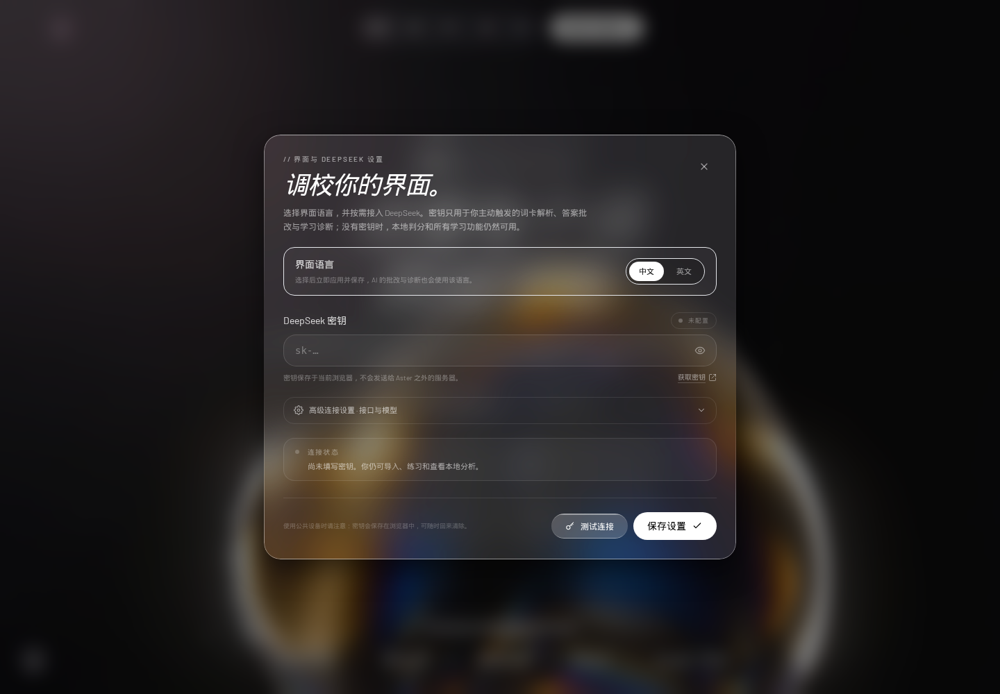

# Aster 词航 · Lexicon Voyage

> **在线使用：** https://pioneer-stomic.github.io/aster-lexicon-voyage/  
> **GitHub：** https://github.com/Pioneer-Stomic/aster-lexicon-voyage

一个可以直接使用的单词学习 Web App：Excel 批量导入、词性快捷键选择、中文 / 英文释义作答、DeepSeek 语义批改，以及逐词逐项的掌握度可视化。支持**中文 / English 界面切换**。

界面采用电影感深空背景 + 液态玻璃设计系统，包含一个完整的 Hero → Capabilities 单页落地页，以及 Study / Lexicon / Insights 三个可用的学习工作区。


更多界面预览见 [`preview/`](preview/)。

---

## 快速开始

### 方式一：直接打开（零配置）

双击 `index.html`，或在浏览器中打开 `file:///.../lexicon-voyager/index.html`。

### 方式二：启动本地静态服务（推荐）

```bash
cd lexicon-voyager
python3 -m http.server 4173
```

然后访问：

```text
http://127.0.0.1:4173/
```

本地 HTTP 方式下，`localStorage`、文件选择与跨域接口的浏览器行为最稳定。

### 切换界面语言

1. 点击页面 **左下角的齿轮图标**。
2. 在「界面语言 / Interface language」中选择 **中文** 或 **英文**。默认界面语言为中文。
3. 切换立即生效并保存在当前浏览器，无需额外保存。

界面文案、状态标签、图表标签、快捷键说明、提示与错误信息都会跟随所选语言。之后触发的 AI 批改、AI 诊断与 AI 词卡解析也会使用同一语言；已经生成的历史批改内容和词卡本身的中英文学习内容保持原样。



English 界面预览：[preview/hero-en.png](preview/hero-en.png)、[preview/study-en.png](preview/study-en.png)、[preview/settings-en.png](preview/settings-en.png)。

### 接入 DeepSeek

1. 点击页面 **左下角的齿轮图标**。
2. 填入 DeepSeek API Key（可在 <https://platform.deepseek.com/api_keys> 获取）。
3. 点击「测试连接」确认网络与 Key 可用；点击「保存设置」启用。
4. 如需使用兼容接口，展开「高级连接设置」修改 Base URL 和 Model。

- 默认模型：`deepseek-chat`
- 默认 Endpoint：`https://api.deepseek.com/chat/completions`
- API Key 只保存在当前浏览器的 `localStorage` 中，由浏览器直接请求你填写的接口地址，不经过 Aster 的服务器。
- 不接入 AI 也可以完整使用导入、练习、本地判分、学习和分析功能。

示例词库已内置参考图中的 14 个单词，打开即可开始背。

---

## 功能

### 1. 单词导入

- 支持 `.xlsx`、`.xls`、`.csv`，读取第一张工作表。
- 自动识别表头：
  | A | B | C | D |
  |---|---|---|---|
  | 英文单词 | 词性 | 英文解释 | 中文解释 |
- 没有表头时也可以按 A / B / C / D 列读取；忽略空行与重复单词。
- 可以下载标准 Excel 模板。
- 导入时可选：
  - **直接生成词卡**：保留原表数据，立刻可用。
  - **AI 解析并生成**：DeepSeek 规范词性、为每个词补充中文记忆钩子、标签与难度。原始释义不会被随意改写。
- AI 解析按批次处理，单批失败会保留原始数据；全部失败时会回退并允许直接生成。

### 2. 作答与批改

每题包含三项：

- **词性**：点击按钮或用键盘 `1`–`8` 选择，支持多选。`comment` 这类 `noun/verb` 单词可以同时选中两个词性。
- **中文释义**
- **英文释义**

快捷操作：

| 按键 | 行为 |
|---|---|
| `1` ~ `8` | 选择 / 取消词性 |
| `Ctrl / ⌘ + Enter` | 提交批改 |
| `Enter` | 在批改结果页进入下一词 |

接入 DeepSeek 后，AI 会对照词卡理解你的同义表达，分别给出词性、中文、英文三项分数与中文诊断。AI **只做分析批改，不会替你答题或提前泄露答案**；提交后才会展示参考答案。

未接入 AI，或 AI 请求失败时，自动回退到本地关键词/义项匹配，并在界面明确标注「本地判分，仅供参考」。

#### 语义优先评分规则

- **完全一致直接 100 分**：忽略大小写、空格与标点后，答案与参考一致时强制满分，不接受模型给出的异常低分。
- AI 不再直接决定最终分数，只输出语义证据：`relation`（exact / equivalent / partial / incorrect / blank）、`coverage`（语义覆盖）、`precision`（准确度）、`expression`（表达）。
- 客户端统一计算：**语义覆盖 70% + 准确度 25% + 表达 5%**。
- **语义等价**（同义改写、近义表达、轻微语法问题）自动获得至少 88 分；核心高覆盖自动至少 92 分。
- 语法、拼写只占 5%，不会再因为表达不标准而把正确的词义判成低分。
- 参考卡中使用 `or`、斜杠或并列同义词时，只要命中一种同义表达即可，不把所有替代写法当成必须全部答出的义项。
- 词性、中文、英文三项独立评分；一项错误不会连坐其他项。
- 词性仍由固定规则判定；综合分数仍按词性 20% / 中文 40% / 英文 40% 计算。

### 3. 学习分析

进入 Insights 可以查看：

- 三项能力平均分与综合掌握度
- 三角形掌握雷达图
- 逐词掌握热力图：每个单词的词性 / 中文 / 英文分别计分，低于稳定线的分项会标记为 `FOCUS`
- 最近学习日的每日平均分趋势
- 下一轮优先重练队列
- 可选的 AI 学习诊断（基于聚合后的分数与弱项，不读取原始 API Key）

分数按最近 3 次练习的逐项平均值计算。综合掌握度权重为：

```text
词性 20% + 中文释义 40% + 英文释义 40%
```

### 4. 语言与词库

- 设置中可在中文 / 英文（English）之间即时切换界面
- 搜索单词、中文/英文释义、标签
- 筛选全部 / 待强化 / 已稳定 / 未学习
- 单独重练一张词卡
- 删除词卡（同时删除其历史记录）

---

## 数据和隐私

- 词卡、学习记录、界面语言设置、API 设置与 Coach 诊断均只保存在浏览器 `localStorage`，键名为 `aster-lexicon-voyage:v1`。
- 应用没有账号、后端数据库或云同步。
- 深度学习记录不会离开浏览器；只有在你主动提交批改、导入解析或生成 AI 诊断时，相关文本才会直接发往设置中的 DeepSeek（或你填写的兼容接口）地址。
- 公共设备上使用后，可在设置中清除 API Key。
- 清除浏览器站点数据会清空全部学习记录，建议不要清理该站点的存储。

---

## 项目结构

```text
lexicon-voyager/
├─ index.html            # 可直接运行的单文件应用（构建产物，所有逻辑已内联）
├─ README.md
├─ build.mjs             # 将 src/ 与样式模板打包成 index.html
├─ displacement.b64      # 液态玻璃 SVG 折射位移贴图（base64 PNG）
├─ src/
│  ├─ template.html      # HTML、字体、CDN 依赖、液态玻璃 CSS
│  ├─ app-core.jsx       # 数据层、DeepSeek、批改、导入、首页
│  ├─ app-study.jsx      # 练习、结果、Session 总结
│  ├─ app-pages.jsx      # 词库、雷达图、热力图、AI Coach
│  └─ app-modals.jsx     # 设置、导入弹窗、Toast、App 根组件
└─ preview/              # 界面预览截图
```

`index.html` 不依赖本项目内的 JS 文件，可直接单独运行。需要联网加载的第三方资源：

- Tailwind CSS CDN
- React 18 / ReactDOM UMD
- Babel Standalone
- Framer Motion 11
- SheetJS
- Google Fonts（Instrument Serif / Barlow）
- 两段 CloudFront 背景视频

---

## 重新构建

修改 `src/` 后，在项目根目录运行：

```bash
node build.mjs
```

会把最新的组件、样式和折射贴图重新内联为 `index.html`。开发时已用 Playwright 验证首页动效、本地/AI 批改、Excel 导入、AI 词卡生成、分析页、Session 完成、删除、移动端布局与 `file://` 直接打开等流程。

## 已知边界

- 需要联网加载字体、框架、SheetJS 和背景视频，离线无法完整渲染。
- 本地判分只用规则匹配，无法真正理解同义表达；需要准确度时请接入 DeepSeek。
- 当前是单浏览器、单用户的本地应用，不支持多设备同步或多人协作。
- 导入词表在原表缺少词性时默认记为 `other`；使用 AI 解析可自动补全。
- 界面切换不会改写已保存的学习内容；单词释义、记忆钩子以及已生成的历史批改文本会保留其原始语言。
